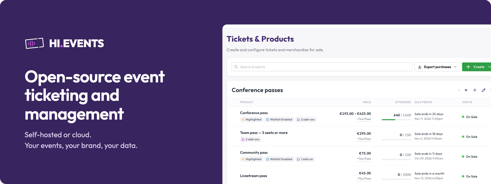
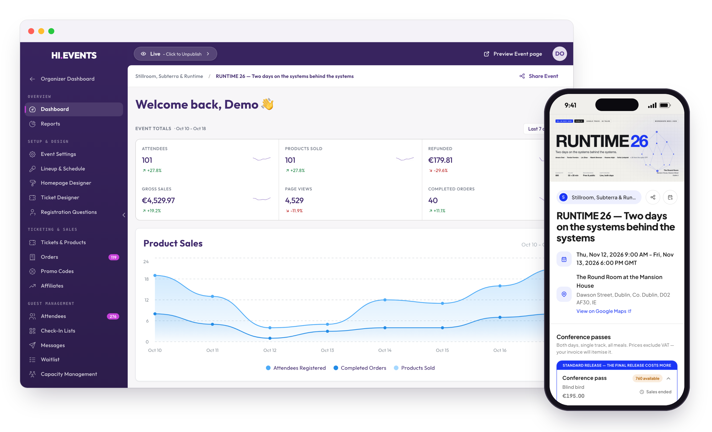

<div align="center">



# Hi.Events

### Open-source platform voor ticketverkoop en eventbeheer

Verkoop online tickets voor conferenties, nightlife-events, concerten, clubavonden, workshops en festivals.<br>
Zelf gehost of in de cloud. Jouw events, jouw merk, jouw data.

[Probeer Cloud →](https://app.hi.events/auth/register?utm_source=gh-readme) · [Live demo](https://app.hi.events/event/2/hievents-conference-2030?utm_source=gh-readme) · [Documentatie](https://hi.events/docs?utm_source=gh-readme) · [Enterprise & licenties](https://hi.events/licensing?utm_source=gh-readme) · [Website](https://hi.events?utm_source=gh-readme)

[](https://github.com/HiEventsDev/hi.events/blob/develop/LICENCE)
[](https://github.com/HiEventsDev/hi.events/releases)
[](https://github.com/HiEventsDev/hi.events)
[](https://hub.docker.com/r/daveearley/hi.events-all-in-one)
[](https://github.com/HiEventsDev/hi.events/actions/workflows/e2e.yml)

<a href="https://trendshift.io/repositories/10563" target="_blank">
  
</a>

<p>
<a href="README.md">English</a> · <a href="README.de.md">Deutsch</a> · <a href="README.fr.md">Français</a> · <a href="README.it.md">Italiano</a> · <a href="README.nl.md">Nederlands</a> · <a href="README.es.md">Español</a> · <a href="README.pt.md">Português</a> · <a href="README.pt-br.md">Português (Brasil)</a> · <a href="README.pl.md">Polski</a> · <a href="README.sk.md">Slovenčina</a> · <a href="README.hu.md">Magyar</a> · <a href="README.sv.md">Svenska</a> · <a href="README.fi.md">Suomi</a> · <a href="README.el.md">Ελληνικά</a> · <a href="README.tr.md">Türkçe</a> · <a href="README.vi.md">Tiếng Việt</a> · <a href="README.zh-cn.md">简体中文</a> · <a href="README.zh-hk.md">繁體中文</a> · <a href="README.ja.md">日本語</a> · <a href="README.ko.md">한국어</a>
</p>

</div>

<br>

> [!NOTE]
> **Hi.Events 2.0 is er** met terugkerende events, gereserveerde zitplaatsen, een kassa, line-ups en programma's, single
> sign-on, teamrechten en API-sleutels. [Bekijk wat er nieuw is →](https://github.com/HiEventsDev/hi.events/releases)

<br>



<br>

## Waarom Hi.Events?

De meeste ticketplatforms rekenen kosten per ticket en houden je klantgegevens zelf. **Hi.Events is een open-source
alternatief voor Eventbrite, Tickettailor, Dice.fm en andere ticketplatforms** waarmee je volledige controle houdt over je
branding, checkout en data.

Duizenden organisatoren wereldwijd vertrouwen erop: van nightlife-promotors en festivals tot venues, verenigingen
en conferentieorganisatoren. Host het zelf, of laat ons het voor je beheren met Hi.Events Cloud.

<br>

## Functies

**📅 Events**
- Eenmalige en terugkerende events, met prijzen, capaciteit en tijden per datum
- Een event dupliceren met één klik
- Opgeslagen locaties en online events
- Designer voor de eventpagina en organisatorpagina's in je eigen huisstijl
- Pagina's voor line-up en programma

**🎟️ Tickets & producten**
- Betaalde, gratis, donatie- en gestaffelde tickets
- Gereserveerde zitplaatsen <sup>Enterprise</sup>
- Add-ons en merchandise
- Verborgen tickets die je vrijgeeft met kortingscodes
- Limieten per bestelling en geplande verkoopperiodes
- Gedeelde capaciteit en automatische wachtlijsten

**🛒 Verkoop**
- Aanpasbare embeds voor je eigen site: ticketwidgets, knoppen, eventlijsten, line-ups en programma's
- Kortingscodes en acties
- Trackinglinks voor promotors en affiliates
- Eigen registratievragen
- Marketingtoestemming bij het afrekenen
- Tracking via Meta, TikTok, Google Analytics en Tag Manager

**💳 Betalingen**
- Uitbetalingen naar je eigen Stripe-account
- Belastingen en kosten, inbegrepen of toegevoegd bij het afrekenen
- Facturatie en offline betalingen
- Volledige en gedeeltelijke terugbetalingen

**🚪 Deelnemers & de deur**
- Kassa voor verkoop aan de deur <sup>Enterprise</sup>
- Inchecken met de camera van je telefoon of een USB-scanner
- Deelbare inchecklijsten met live tellingen
- Berichten aan deelnemers en eigen e-mailsjablonen
- PDF-tickets in je eigen huisstijl
- Handmatig toegevoegde deelnemers
- Rapporten over verkoop, belastingen en kortingscodes

<br>

## Gemaakt voor organisaties

**🔐 Beveiliging & toegang**
- Single sign-on
- Tweestapsverificatie
- Teamrollen en rechten
- Meerdere organisatoren onder één account

**🔌 Integraties**
- REST API en API-sleutels
- Webhooks
- Exports naar CSV en XLSX

**🗄️ Jouw data**
- Zelf hosten met Docker
- Accountverwijdering en anonimisering
- Beschikbaar in 20 talen

**✅ Getest**
- Bij elke wijziging draait een uitgebreide testsuite

<br>

## Snel aan de slag

Gebouwd met **Laravel 13** (PHP >=8.3) · **React 19** met SSR · **TypeScript** · **PostgreSQL** · **Redis** · **Docker**.

### Deployen met één klik

[](https://github.com/HiEventsDev/hi.events-digitalocean)
[](https://github.com/HiEventsDev/hi.events-render.com)
[](https://railway.com/deploy/8CGKmu?referralCode=KvSr11)
[](https://zeabur.com/templates/8DIRY6)

### Docker

```bash
git clone https://github.com/HiEventsDev/hi.events.git
cd hi.events/docker/all-in-one

cp .env.example .env

# Generate keys (Linux/macOS)
echo "APP_KEY=base64:$(openssl rand -base64 32)" >> .env
echo "JWT_SECRET=$(openssl rand -base64 32)" >> .env

docker compose up -d
```

> [!TIP]
> **Windows-gebruikers:** zie `./docker/all-in-one/README.md` voor instructies om de sleutels te genereren.

Open `http://localhost:8123` en maak je account aan.

📖 [Volledige installatiehandleiding](https://hi.events/docs/getting-started?utm_source=gh-readme)

> [!IMPORTANT]
> **Upgrade je vanaf 1.x?** Lees eerst de [release notes](https://github.com/HiEventsDev/hi.events/releases).

### REST API

Maak API-sleutels aan onder **Instellingen → API-sleutels**. Daar vind je ook de API-referentie.

<br>

## Talen

Engels, Deutsch, Français, Italiano, Nederlands, Español, Português, Português (Brasil),
Polski, Slovenčina, Magyar, Svenska, Suomi, Ελληνικά, Türkçe, Tiếng Việt, 简体中文, 繁體中文, 日本語 en 한국어.

Correcties en nieuwe talen zijn welkom: zie de [richtlijnen voor bijdragen](CONTRIBUTING.md).

<br>

## Hi.Events Cloud

Liever niet zelf hosten? **[Hi.Events Cloud](https://app.hi.events/auth/register?utm_source=gh-readme)** is de volledig
beheerde versie, gerund door het team dat Hi.Events bouwt.

[Aan de slag →](https://app.hi.events/auth/register?utm_source=gh-readme)

<br>

## Licenties

Hi.Events valt onder de **AGPL-3.0 met aanvullende voorwaarden**. Die voorwaarden vereisen dat de vermelding "Powered by Hi.Events"
behouden blijft op pagina's en e-mails die de software genereert. Zie [LICENCE](LICENCE) voor de exacte tekst.

Gereserveerde zitplaatsen en de kassa vallen onder de [Hi.Events Enterprise Licence](backend/ee/LICENCE) en vereisen een
licentie voor productiegebruik.

**Commerciële licenties zijn beschikbaar** als je de vermelding wilt verwijderen of voorwaarden nodig hebt voor een
white-label-implementatie. [Licentieopties](https://hi.events/licensing?utm_source=gh-readme) ·
[hello@hi.events](mailto:hello@hi.events)

<br>

## Bijdragen

Bijdragen zijn welkom: lees de [richtlijnen voor bijdragen](CONTRIBUTING.md) om te beginnen. Open een issue of
discussie voordat je aan groter werk begint, zodat we de aanpak kunnen afstemmen. Bijdragers ondertekenen
een [CLA](CLA.md).

<a href="https://github.com/HiEventsDev/hi.events/graphs/contributors">
  
</a>

<br>

## Beveiliging

Een kwetsbaarheid gevonden? Meld die vertrouwelijk via [security@hi.events](mailto:security@hi.events) in plaats van
een openbare issue te openen. Zie ons [beveiligingsbeleid](SECURITY.md).

<br>

## Support

📖 [Documentatie](https://hi.events/docs?utm_source=gh-readme) ·
🐛 [GitHub Issues](https://github.com/HiEventsDev/hi.events/issues) ·
💬 [Discussies](https://github.com/HiEventsDev/hi.events/discussions) ·
📧 [hello@hi.events](mailto:hello@hi.events)

Nieuwe functies en verbeteringen vind je op
de [releasepagina](https://github.com/HiEventsDev/hi.events/releases).

<br>

<div align="center">

**[Website](https://hi.events)** · **[Documentatie](https://hi.events/docs)** · **[Cloud](https://app.hi.events/auth/register?utm_source=gh-readme)** · **[Licenties](https://hi.events/licensing)**

Gemaakt met ☘️ in Ierland

</div>
